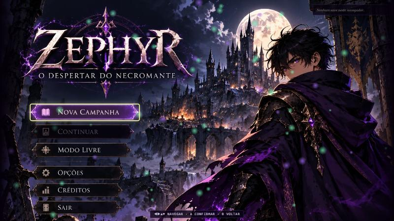

# ☠ Necromancer's Rise

Jogo de ação top-down em HTML5 Canvas 2D, num único arquivo e sem dependências.
Você é **Zephyr**, um aprendiz condenado que volta como necromante: lança magias
de osso, ergue uma horda de mortos-vivos e enfrenta a guarda do Reino de Valdoria.

### ▶ [Jogar agora](https://elton182.github.io/necromancer-rise-html-game/)

[](https://elton182.github.io/necromancer-rise-html-game/)

## Estado atual — versão 0.5

O jogo é uma **demo jogável do Ato I** com um endgame curto. Funciona no
navegador, com teclado e mouse ou controle, e salva o progresso localmente.

| Sistema | Situação |
|---|---|
| Campanha — Ato I | 4 fases (salas, arena, rolagem lateral e chefe), quadrinhos de história e mapa para rejogar |
| Modo Livre e Vila de Eldrin | Hub com missões, moradores com pedidos, trilhas laterais e mercador |
| Pedra do Infinito | Expedições por mapas e biomas, elites e boss por wave; Arena clássica preservada; seleção até 1000 |
| Conquista de Valdoria | Mapa com 17 áreas e 6 biomas até a torre; influência, 6 maldições e 2 tenentes; dificuldade sem teto, novo mapa ao trocar de nível e seleção automática da maior liberada; acesso em Esc → VALDORIA na vila |
| Habilidades | 6 slots compartilhados entre 6 magias, Dash e 5 evocações com comandos próprios |
| Grimório | 2 árvores, 6 escolas, 42 nós e 12 especializações finais; 3 pontos por nível até o 60 |
| Maestrias | 6 especializações vinculadas à barra, escolhidas entre 12 habilidades; níveis até 20 e árvores com até 19 pontos próprios |
| Horda | Zumbis, esqueletos guerreiros e arqueiros, espectros e Abominação, com IA, esquiva, reanimação e uma habilidade automática com recarga por tipo |
| Inimigos | 6 tipos comuns com especiais anunciados, 3 chefes de missão e o Capitão da Guarda (4 fases) |
| Boss das expedições | Carcereiro das Almas: modelo e rig no Blender, sete animações em oito direções, duas fases e três ataques anunciados |
| Equipamentos | 7 espaços, 4 raridades, afixos, pontos de habilidade, mochila de 60 peças e filtro de loot |
| Visual | Sprites renderizados no Blender em 8 direções, novo Tiro de Osso e arena de comparação de efeitos |

Os valores de combate ainda são **iniciais** e precisam de balanceamento com
partidas completas. Em andamento no working tree: o sprite próprio dos
**Estilhaços** do Tiro de Osso (`blender/models/bone_shard.blend`, `scripts/skill-vfx.js`).
O próximo cartão do [roadmap visual](docs/roadmap-combate-visual.md) é o Dash
(SK-02), com o Cão de Cripta (EN-01) já disponível nas waves e expedições a partir da wave 4.

## Como jogar

| Tecla | Ação |
|---|---|
| `W A S D` | Mover |
| Clique esquerdo / `1` | Slot de habilidade 1 |
| Clique direito / `2` | Slot 2 |
| `Q` `E` `R` `T` / `3`–`6` | Slots 3 a 6 |
| `Shift` + clique direito | Horda: atacar perto do ponto ou reunir |
| `C` / `Espaço` | Dash / Escudo de Carne, se equipados |
| `V` | Reanimar aliado caído (30 MP) |
| `G` | Interagir / portal |
| `F1`–`F5` | Consumíveis |
| `I` | Inventário |
| `H` | Ajuda |
| `ESC` | Pausa: Personagem, Habilidades, Horda, Sistema, Equipamentos e Waves |

Clique num slot do HUD para trocar sua habilidade e no contador `✦ pts` para abrir o
Grimório. No controle: analógicos movem e miram, `RT`/`A` usam o slot selecionado,
`LB`/`RB` trocam de slot, `LT` comanda a horda e `L3` usa o Dash.
[Mapa completo de controles](docs/mecanicas/interface-e-saves.md#controles).

## Mecânicas em resumo

A referência completa, com fórmulas e tabelas, está em
[docs/mecanicas](docs/mecanicas/README.md).

- **[Personagem](docs/mecanicas/personagem-e-progressao.md)**
  - Vida, mana, dano mágico e regeneração crescem com o nível.
  - Cada nível dá **3 pontos** de habilidade e +20 de vida e +5 de mana imediatos.
  - Morrer devolve Zephyr ao hub (ou ao mapa, na campanha) com 50% da vida, sem
    perder ouro, XP ou itens da mochila.
- **[Habilidades](docs/mecanicas/habilidades.md)**
  - Começa com Tiro de Osso e Dash.
  - Magias: Chuva de Ossos, Explosão Necrótica, Muralha de Corpos, Escudo de Carne
    (sacrifica um zumbi) e Maldição da Fraqueza.
  - Todas usam mana, recarga e alcance 9; o Dash é gratuito e evita dano durante o
    deslocamento.
- **[Grimório dos Mortos](docs/mecanicas/grimorio.md)**
  - **Minions** (Carne, Ossos, Espíritos) e **Profana** (Ossos, Sangue, Sombras).
  - Cada escola tem raiz, dois ramos e duas especializações finais exclusivas.
  - Etapas nos níveis 1, 6, 12 e 22; cada ligação exige 2 pontos no nó anterior.
  - Devolver pontos custa 20 de ouro por ponto.
- **[Horda](docs/mecanicas/horda.md)**
  - Uma evocação ocupa um slot e traz o grupo inteiro (3 zumbis, 3 guerreiros,
    2 arqueiros, 2 espectros ou 1 Abominação).
  - Ativar o slot usa o comando do grupo: explosão, salva de flechas, salto,
    teletransporte ou reunião.
  - Os aliados escolhem alvos dentro de um alcance configurável (8, 16 ou 24 u),
    desviam de ataques anunciados e renascem após 12 s.
- **[Inimigos](docs/mecanicas/inimigos-e-chefes.md)**
  - Guerreiro, Arqueiro, Bruto e Mago Vivo anunciam seus especiais; sair da área
    marcada evita o golpe.
  - Acólito de Guerra fortalece inimigos próximos com uma litania interrompida pela morte; aparece a partir da wave 6 na Arena e nas Expedições.
  - Missões terminam com Guardião dos Ossos, Lich Guerreiro ou Hidra Pútrida.
  - O Ato I termina no Capitão da Guarda, com escudo e reforços a cada 25% de vida.
- **[Equipamentos](docs/mecanicas/equipamentos-e-loot.md)**
  - Cajado, grimório, vestimenta, capuz, botas e dois anéis.
  - Raridades com 0, 2, 3 ou 4 afixos.
  - 16% de chance de drop por monstro; chefes garantem mágico ou melhor.
  - Itens podem dar pontos extras em habilidades já aprendidas.
  - Compra de relíquias e venda no hub.
- **[Modos de jogo](docs/mecanicas/modos-de-jogo.md)**
  - Campanha e Modo Livre compartilham o mesmo personagem.
  - O Modo Livre começa na Vila de Eldrin, com moradores e Pedra do Infinito, sem exigir a conclusão do Ato I.
  - Na Arena Infinita, a maior wave desbloqueada define o nível do loot vendido.

## Rodando localmente

Não precisa de build nem servidor: abra `necromancer-canvas.html` no navegador.
`index.html` só redireciona para ele (entrada do GitHub Pages).

O progresso fica no `localStorage` do navegador (chave `necromancer_v2`). Use
**Opções → Exportar/Importar save** para backup.

Para diagnosticar combate com sua build, exporte em **Esc → Sistema → Exportar save**
e use a [simulação de save no motor real](balance-simulator/SAVE-SIMULATION.md).
Ela roda tentativas reproduzíveis em navegador isolado, preservando seu progresso.

## Desenvolvimento

### Estrutura

| Caminho | Descrição |
|---|---|
| `necromancer-canvas.html` | **Versão atual** do jogo, autocontida (código, estilos, sprites e módulos embutidos) |
| `scripts/` | Fontes dos módulos embutidos, scripts de sincronização e testes |
| `build-simulator/` | [Simulador de builds](build-simulator/README.md); `model.js` é o grafo do Grimório usado pelo jogo |
| `balance-simulator/` | [Simulador de balanceamento](balance-simulator/README.md) de equipamentos e waves |
| `tools/` | Arena de comparação de efeitos e inimigos (`combat-lab`) |
| `blender/` | Modelos, rigs e scripts Python que geram os spritesheets |
| `assets/story/` | Imagens dos quadrinhos |
| `docs/` | [Documentação](docs/README.md): mecânicas, implementação e planos |
| `game_check.js` | Cenários de regras do jogo (Node, sem dependências) |
| `necromancer-game.html`, `necromancer-demo.html` | Versões antigas (Three.js e demo visual) |

### Módulos embutidos

O jogo distribuído continua sendo um único HTML. Alguns sistemas são editados em
arquivos separados e copiados para dentro dele:

| Fonte | Sistema | Sincronizar com |
|---|---|---|
| `build-simulator/model.js`, `scripts/skill-trees.js`, `scripts/skill-trees.css` | Grimório e regras de combate (`COMBAT_TUNING`) | `node scripts/sync-skill-trees.js` |
| `scripts/equipment-model.js`, `scripts/equipment.js`, `scripts/minion-care.js`, `scripts/minion-abilities.js`, `scripts/sprite-cache.js`, `scripts/equipment.css`, `scripts/menu.css` | Equipamentos, loot, waves, reanimação, esquiva e habilidades automáticas da horda, cache de sprites, menu | `node scripts/sync-equipment.js` (também roda o anterior) |
| `scripts/expedition-model.js`, `scripts/expedition.js` | Mapas de expedição, biomas por wave, elites, boss e seleção entre Expedição e Arena clássica | `node scripts/sync-equipment.js` |
| `scripts/endgame-model.js`, `scripts/endgame.js`, `scripts/endgame-map.js`, `scripts/endgame-screen.js`, `scripts/endgame.css` | Tela dedicada e mapa territorial em Canvas 2D, conquista regional, maldições, líderes do pântano e Osso Carcomido/Podridão | `node scripts/sync-equipment.js` |
| `scripts/war-acolyte-model.js`, `scripts/war-acolyte.js` | Acólito de Guerra, aura de dano e composição de grupos | `node scripts/sync-equipment.js` |
| `scripts/crypt-hound-model.js`, `scripts/crypt-hound.js` | Composição da arena e combate do Cão de Cripta | `node scripts/sync-equipment.js` |
| `scripts/skill-vfx.js` | Efeitos do Tiro de Osso e do Dash | `node scripts/sync-skill-vfx.js` |

Edite a fonte e rode o script; não edite o bloco embutido direto no HTML.

### Verificação

```bash
node game_check.js
```

```bash
node --test scripts/equipment.test.js scripts/minion-care.test.js scripts/minion-abilities.test.js scripts/sprite-cache.test.js scripts/skill-trees.test.js scripts/navigation-options.test.js build-simulator/model.test.js balance-simulator/model.test.js
```

- `game_check.js` valida a sintaxe e roda os 71 cenários de regras.
- Os testes `node --test` (105 casos) cobrem modelos, migrações, sinergias e
  estatísticas.
- Os arquivos `scripts/*-browser-check.js` abrem o jogo num Chrome headless e
  conferem fluxos de interface. Exigem Playwright e Google Chrome instalados, por
  exemplo `node scripts/loot-filter-browser-check.js`.

### Arena de comparação

```bash
node tools/combat-lab-server.js
```

Depois acesse `http://127.0.0.1:4173/tools/combat-lab.html`. A arena usa os sprites
e o renderizador reais para comparar efeitos e inimigos no tamanho do jogo
(veja o [guia visual](docs/guia-visual-combate.md)).

### Pipeline de sprites (Blender)

Personagens e efeitos são modelados e animados por script no Blender e
renderizados como spritesheets com shader toon: 8 direções para personagens e
16 para o estilhaço de osso. Detalhes em [blender/README.md](blender/README.md).


- `necromante.py`, `mob.py`, `undead_ranged.py` e `bone_shard.py` constroem modelo,
  rig e animações (`.blend` / `.glb`).
- `sprites.py`, `render_undead.py` e `render_bone_shard.py` renderizam os quadros.
- `pack_undead.py` e `pack_bone_shard.py` montam o spritesheet (`*_sheet.webp`) e os
  metadados (`*_sheet.json`) e os incorporam ao HTML do jogo (exigem Python com
  Pillow).
- `render.py` gera previews; `toon.py` e `common.py` são utilitários compartilhados.

```bash
blender -b -P blender/scripts/sprites.py -- blender/models/necromante.blend blender/spritesheets necromante
```
