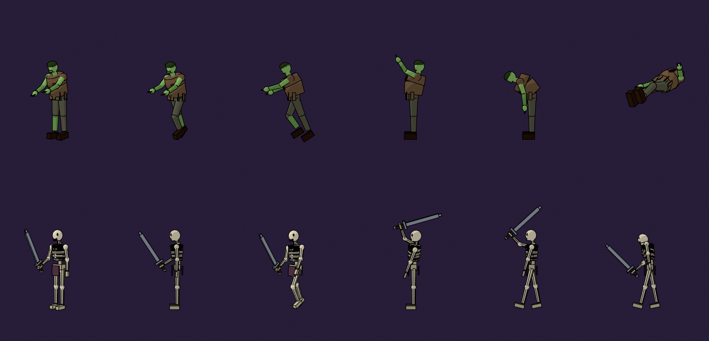

# ☠ Necromancer's Rise

Jogo de ação top-down feito em HTML5 Canvas 2D, em um único arquivo, sem dependências. Você é um necromante: lança feitiços, ergue mortos-vivos para lutar ao seu lado e sobrevive a ondas de inimigos.

### ▶ [Jogar agora](https://elton182.github.io/necromancer-rise-html-game/)



## Como jogar

| Tecla | Ação |
|---|---|
| `W A S D` | Mover o necromante |
| Clique esquerdo | Lançar a magia selecionada |
| `1` `2` `3` `4` | Trocar de magia |
| `ESPAÇO` | Barreira Arcana |
| `Q` | Círculo de invocação (minions) |
| Clique direito | Reunir minions (no chão) ou mandar atacar (no inimigo) |
| `R` | Reanimar minion caído |
| `E` | Portal / interagir |
| `F1`–`F5` | Usar itens do inventário |
| `ESC` | Pausa e menu (status, habilidades, upgrades) |

Também dá para jogar com controle (gamepad).

## Rodando localmente

Não precisa de build nem servidor: basta abrir `necromancer-canvas.html` no navegador.

## Estrutura

| Arquivo | Descrição |
|---|---|
| `necromancer-canvas.html` | **Versão atual** do jogo (Canvas 2D, sprites embutidos) |
| `index.html` | Entrada do GitHub Pages, redireciona para a versão atual |
| `necromancer-game.html` | Versão anterior (Three.js) |
| `necromancer-demo.html` | Demo visual inicial |
| `blender/` | Modelos, rigs e scripts Python que geram os spritesheets |

### Pipeline de sprites (Blender)

Os personagens (necromante, zumbi e esqueleto) são modelados e animados por script no Blender e renderizados como spritesheets de 8 direções com shader toon:

- `necromante.py`, `mob.py` — constroem modelo, rig e animações (`.blend` / `.glb`)
- `sprites.py` — renderiza o spritesheet (`*_sheet.webp`) e os metadados (`*_sheet.json`)
- `render.py` — renders de preview
- `toon.py`, `common.py` — utilitários compartilhados

Exemplo:

```bash
blender -b -P blender/sprites.py -- blender/necromante.blend blender necromante
```
