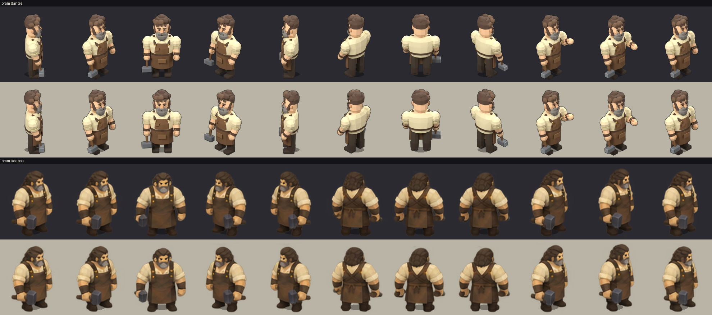
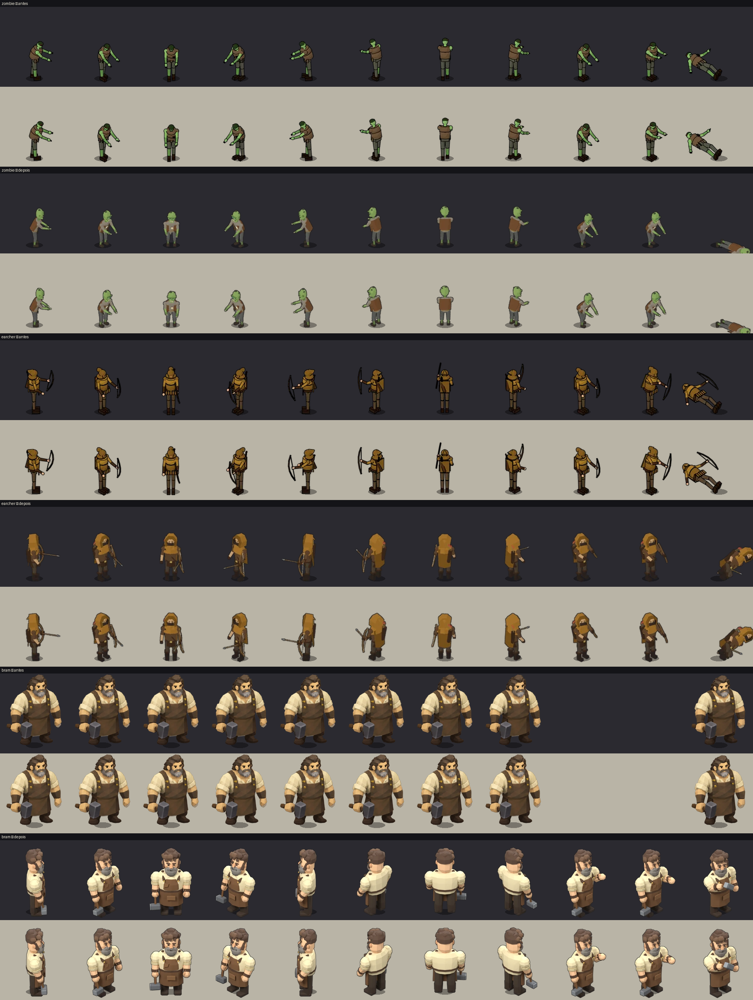
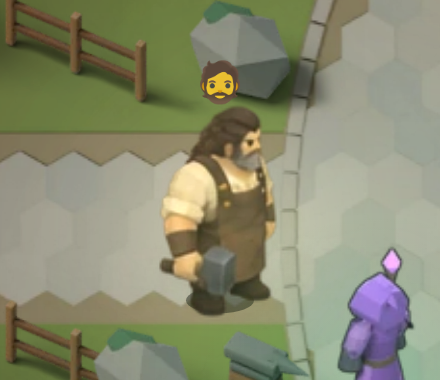

# Revisão da regeneração visual — Lote 1

Registro do Lote 1 da regeneração low-poly. O inventário e o diagnóstico do pipeline estão em [character-regeneration-inventory.md](character-regeneration-inventory.md). Os Lotes 2 e 3 não foram iniciados e aguardam validação.

## 1. Escopo e decisões

| Personagem | Decisão | Resultado |
|---|---|---|
| Zumbi (`zombie`, aliado) | Regenerar | Modelo Blender novo, 8 direções, 8 animações, mesmo contrato do atlas |
| Arqueiro inimigo (`earcher`, `ENEMY_TYPES[1]`) | Regenerar | Modelo Blender novo, 8 direções, 7 animações, mesmo contrato do atlas |
| Bram (`smith`) | Substituir o sprite pintado por um Bram Blender; depois, usar o atlas 2.5D fornecido pelo usuário | Atlas do usuário fatiado em 8 direções: `idle`, `idle_variation` (bigorna), `talk`. Ver seção 1.1 |
| Zephyr (`necro`) e Esqueleto Guerreiro (`skeleton`) | Só documentar e conferir | Sem re-render; metadados na seção 4 |

- Blender 4.3.2 portátil em `/tmp/blender-4.3.2-linux-x64/`, fora do repositório. Nenhuma dependência foi adicionada ao projeto.
- IDs, chaves `SPR.load`, ordem de `ENEMY_TYPES`, colisões, dano, alcance e recargas não mudaram.
- A camada de apresentação (`scripts/character-visuals.js`) escolhe as linhas novas a partir de estados que o motor já tem.

### 1.1 Bram a partir do atlas 2.5D do usuário

O Bram Blender do Lote 1 foi substituído pelo atlas que o usuário colocou em `blender/spritesheets/lowpoly_bram_sheet.webp`. Os bytes originais foram preservados em `blender/spritesheets/bram_2_5d_source.png`, e o `lowpoly_bram_sheet.webp` voltou ao atlas Blender, recuperado do próprio HTML. O modelo `blender/models/lowpoly_bram.blend` continua disponível.

```sh
python3 blender/scripts/pack_bram_2_5d.py   # --no-embed para só gerar atlas e prancha
```

- A fonte tem 14 × 10 figuras em grade irregular. O empacotador corta as linhas nos vãos transparentes e as colunas entre as figuras, e falha se alguma linha não tiver 14.
- Cada linha tem 7 quadros virados para a direita da tela e 7 para a esquerda. Nas vistas de frente (linhas 0, 3 e 7), a linha inteira é uma só animação, reduzida a 7 quadros alternados.
- Direções, sem espelhamento:

| Clipe | Sudeste e leste | Frente (sul) | Sudoeste e oeste | Costas |
|---|---|---|---|---|
| `idle` 7@5 | linha 1, quadros 0–6 | linha 0 | linha 6, quadros 7–13 | linha 2 |
| `idle_variation` 7@8, em loop | linha 4, quadros 0–6 | linha 3, quadros 0–6 | linha 4, quadros 7–13 | linha 5 |
| `talk` 7@6 | linha 8, quadros 0–6 | linha 7 | linha 8, quadros 7–13 | linha 9 |

- A vista de sudoeste parada usa a linha 6, porque o quadro 7 da linha 1 é uma virada de costas.
- Na vila, o Bram fica em x = −11 e olha para sudeste (`face = π/4`), a única direção vista durante o jogo.
- `idle_variation` é ele martelando a bigorna, que faz parte do sprite e só aparece durante o clipe. `character-visuals.js` toca três ciclos (2,6 s) ao fim de cada período de 12 s.
- Alinhamento: cada quadro é posicionado pelo centro e pela base das 10 linhas inferiores (pés, ou pés e toco). Na bigorna, um deslocamento por direção alinha o tronco ao do `idle` para não saltar na troca (`variationTorsoOffsetPx` no JSON).
- Contrato: célula 144, 38 px/u, âncora (72, 124). A altura na tela é a mesma do Bram anterior (≈ 2,5 u). A arte não é reamostrada nem recebe contorno.
- Atlas: 1008 × 3456, 0,79 MB em WebP e 13,9 MB decodificado (antes 67,3 MB). Saídas: `blender/spritesheets/bram_2_5d_sheet.webp/.json` e `blender/previews/bram_2_5d_comparison.png`.
- Backup do HTML anterior: `blender/backups/necromancer-canvas.before-bram-2-5d.html`.
- Verificado: `node game_check.js` (76/76), `scripts/cast-animations-browser-check.js` e `scripts/lowpoly-cast-browser-check.js` (Bram usa `idle`, `idle_variation` e `talk` na vila), e capturas da vila.



## 2. Pipeline usado

Execute na raiz do projeto:

```sh
blender -b -t 8 --python blender/scripts/lowpoly_cast.py -- --only=zombie,earcher,bram --preview
# Inspecionar blender/frames/lowpoly_<id>_preview/ antes do lote completo.
blender -b -t 8 --python blender/scripts/lowpoly_cast.py -- --only=zombie,earcher,bram
python3 blender/scripts/pack_lowpoly_cast.py --only=zombie,earcher,bram
node game_check.js
node scripts/lowpoly-cast-browser-check.js
node scripts/cast-animations-browser-check.js
```

| Etapa | Arquivos |
|---|---|
| Fonte, rig e ações | `blender/scripts/lowpoly_cast.py` (usa `scripts/common.py`, `character_sculpt.py`, `scripts/toon.py`) |
| Cenas editáveis | `blender/models/lowpoly_zombie.blend`, `lowpoly_earcher.blend`, `lowpoly_bram.blend` |
| GLB com ações | `blender/exports/lowpoly_<id>.glb` |
| Quadros mestres (ignorados pelo Git) | `blender/frames/lowpoly_<id>/RR_FF.png` e `render.json` |
| Atlas e metadados | `blender/spritesheets/lowpoly_<id>_sheet.webp` / `.json` (inclui o bloco `combat`) |
| Validação | `blender/spritesheets/lowpoly_validation.json` |
| Antes/depois | `blender/previews/lowpoly_lote1_comparison.png` |
| Incorporação | `pack_lowpoly_cast.py` substitui somente as linhas `SPR.load('zombie'…)`, `SPR.load('earcher'…)` e `SPR.load('smith'…)` |
| Backup do HTML anterior | `blender/backups/necromancer-canvas.before-lowpoly-lote1.html` (ignorado pelo Git) |

Renderização:
- Câmera ortográfica a 32°.
- Armadura girada `90 - di × 45` graus.
- Mestres maiores que a célula final: 256 px para zumbi e arqueiro, 340 px para Bram.
- Contorno escuro de 1 px no alfa e redução LANCZOS.
- Zumbi e arqueiro usam o toon de três faixas do esqueleto de referência (`toonify`, faixas 0,65 / 0,84 / 1).
- Bram usa estúdio suave em Cycles com 96 amostras, como Zephyr, para manter os planos largos do sprite pintado.

O empacotador recusa quadros vazios, recortados (margem de 2 px no mestre) ou animações estáticas em qualquer direção.

## 3. Contratos e escala

| Chave | Célula | ppu | Âncora | Atlas | Altura aparente (antes → depois) | Memória decodificada (antes → depois) |
|---|---|---|---|---|---|---|
| `zombie` | 224 | 56 | (112, 165) | 1344×14336 | 90 → 89 px (1,69 u na tela) | 64,2 → 77,1 MB |
| `earcher` | 224 | 56 | (112, 165) | 1344×12544 | 103 → 103 px (2,13 u na tela) | 64,2 → 67,4 MB |
| `smith` | 296 | 108 → **96** | (156, 294) → **(148, 262)** | 6216×1184 → 2368×7104 | 2,65 u → 2,65 u (2,92 u na tela) | 29,4 → 67,3 MB |

- Zumbi e arqueiro mantêm célula, ppu e âncora. A escala de desenho (`1,05` e `1,05 × 0,85 × 1,3`) não mudou.
- Bram mantém a célula de 296 px e a altura na tela. O ppu e a âncora mudaram por necessidade: com 108 px/u, a figura de 286 px ocupava a célula inteira. Isso não deixava margem para os pés à frente nas 8 direções, nem para o martelo erguido.
- Pés: a base do `idle` varia 6 px entre direções no zumbi e no arqueiro, e 18 px no Bram. A diferença vem da perspectiva (pé ou martelo à frente na vista sul, calcanhar na vista norte). A âncora é a mesma origem do modelo em todas as direções.
- O HTML passou de 34,99 MB para 36,03 MB.

## 4. Metadados de animação e impacto

O motor aplica o dano básico **no mesmo quadro** em que inicia `swing`. Não existe evento de impacto atrasado. Por isso, nos ataques básicos o quadro 0 é o impacto e os seguintes são recuperação. Atrasar o dano para mostrar uma preparação exige mudar o combate, o que ficou fora do escopo.

### Zumbi

| Linha | Quadros@fps | Seleção no jogo |
|---|---|---|
| `idle` | 6@6 | Parado |
| `idle_variation` | 6@5 | Parado há 2,5 s, sem alvo vivo, a cada 7–15 s |
| `walk` | 6@10 | Movimento (fase do passo) |
| `attack` | 6@12 | Ataque básico, pelo progresso de `swing` (0,5 s) |
| `attack_secondary` | 6@12 | Mordida Pútrida: `swing > 0` e `_abilityCd` recém-reiniciado para 7 s |
| `spawn` | 6@10 | `ref.spawn > 0` (0,6 s) |
| `hurt` | 3@12 | 0,22 s após aumento de `hit` |
| `death` | 6@10 | `deadT / 0,8`; morto mantém o último quadro |

```json
{"animation":"attack_primary","row":"attack","duration":0.5,"impact_time":0,"recovery_time":0.5,"damage_event":"primary_hit","range":"m.atkR (1,5 u)","damage_type":"físico","cooldown":1.2,"interruptible":false,"directions":8,"cancelable":false}
{"animation":"attack_secondary","row":"attack_secondary","ability":"Mordida Pútrida","duration":0.5,"impact_time":0,"recovery_time":0.5,"damage_event":"minion_ability","damage_type":"150% + 35% de lentidão por 3 s","cooldown":7,"vfx":"burst #9dbf68","directions":8,"cancelable":false}
```

### Arqueiro inimigo

| Linha | Quadros@fps | Seleção no jogo |
|---|---|---|
| `idle` | 6@6 | Parado entre tiros |
| `idle_variation` | 6@5 | Parado há 2,5 s, sem tiro nem movimento |
| `walk` | 6@10 | Aproximação e recuo (não há estado `chase` separado) |
| `attack` | 6@20 | Disparo: quadro 0 é a soltura da corda; o arco baixa em seguida |
| `windup` | 6@9,23 | Tiro forte: `e.ability.phase === 'windup'`, com duração lida de `MOB_ABILITIES['Arqueiro'].windup` (0,65 s com `COMBAT_TUNING`) |
| `hurt` | 3@12 | 0,22 s após aumento de `hit` |
| `death` | 6@10 | `deadT / 0,8`: ajoelha e tomba de lado |

```json
{"animation":"attack_primary","row":"attack","duration":0.28,"impact_time":0,"recovery_time":0.28,"damage_event":"projectile_spawn","range":7.5,"damage_type":"físico (flecha 12 u/s)","cooldown":1.9,"directions":8,"cancelable":false}
{"animation":"cast","row":"windup","ability":"Tiro forte","duration":0.65,"impact_time":0.65,"recovery_time":0.93,"damage_event":"power_shot_spawn","range":12,"damage_type":"físico 1,9× (flecha 18 u/s)","cooldown":5,"vfx":"linha de aviso do motor","interruptible":"morte limpa e.ability","directions":8,"cancelable":false}
```

O Tiro forte é a única preparação real: o arqueiro ergue o arco e puxa a corda durante a linha de aviso. Quando a flecha sai, a linha `attack` mostra a soltura.

### Bram (Blender do Lote 1, substituído pelo atlas 2.5D da seção 1.1)

| Linha | Quadros@fps | Seleção no jogo |
|---|---|---|
| `idle` | 8@6 | Respiração em loop |
| `idle_variation` | 8@5 | Ergue o martelo e olha a cabeça, 1,6 s a cada ciclo de 12 s |
| `talk` | 8@8 | `VIL.open === 'bram'` (`attacking: true` em `drawHubProp`) |

`attack` e `walk` são aliases de `talk` e `idle` no metadado, porque `drawSprite` exige essas linhas. Não foram criadas `hurt` nem `death`: Bram não recebe dano.

### Zephyr e Esqueleto Guerreiro (conferidos, sem re-render)

| Chave | Atlas | Contrato | Animações | Seleção |
|---|---|---|---|---|
| `necro` | 1792×16128 | 224 / 34,3 / (112, 148,4) | idle 4@5, walk 6@12, cast 8@22, summon 8@16, hurt 3@12, death 6@10, nova 8@18, channel 8@16, dash 6@30 | `cast`/`nova`/`channel` pela cor de `castAnim` durante `swing` (0,28 s, impacto no quadro 0); `summon` 0,5 s após invocar; `dash` durante `playerDash` |
| `skeleton` | 1792×10752 | 224 / 42,875 / (112, 157,5) | idle 4@5, walk 6@10, attack 8@20, hurt 3@12, death 6@10, spawn 6@10 | `attack` pelo `swing` de 0,28 s (impacto no quadro 0); Golpe Giratório usa a mesma linha |

Ambos passaram em `cast-animations-browser-check` e `reference-characters-browser-check`, incluindo a checagem de quadros vazios.

## 5. Conferência por personagem

Legenda: **OK** = verificado; **parcial** = verificado com limitação descrita; **n/a** = não se aplica.

| Item | Zumbi | Arqueiro inimigo | Bram | Como foi verificado |
|---|---|---|---|---|
| Idle | OK | OK | OK | Laço real `update()`/`render()` em `lowpoly-cast-browser-check`, mais prancha |
| Variação ociosa | parcial | parcial | OK | Zumbi: no laço real, ociosos orbitam o necromante e usam `walk`. O teste congela a posição e avança só o tempo de render. Arqueiro: não exercitado no jogo (em combate nunca fica 2,5 s parado); conferido no atlas. Bram: verificado no jogo |
| Movimento | OK | OK | n/a | Laço real |
| Ataque | OK | OK | n/a | Laço real; impacto no quadro 0, coerente com o dano |
| Habilidade | OK (Mordida) | OK (Tiro forte) | n/a | Recarga zerada no teste; linhas `attack_secondary` e `windup` desenhadas |
| Fala | n/a | n/a | OK | `VIL.open='bram'` nas 8 direções (`cast-animations`) e captura na vila |
| Dano (`hurt`) | OK | OK | n/a | `hit` elevado no laço real |
| Morte | OK | OK | n/a | Morte real de inimigo e de lacaio; morte do arqueiro reprojetada para caber na célula |
| Sombra e pés | OK | OK | OK | Capturas em escala real (neve e vila); âncora coincide com a sombra |
| Tamanho | OK | OK | OK | Altura medida contra o sprite anterior (seção 3) |
| 8 direções | OK | OK | OK | Prancha de comparação e checagem de quadros vazios em todas as direções |
| Fundo claro/escuro | OK | OK | OK | Prancha com as duas faixas; jogo na neve e na vila |
| Qualidade baixa | OK | OK | não capturado | `review/lowpoly-lote1-combat-low.png` |

## 6. Antes e depois



Capturas no jogo:
- `review/lowpoly-lote1-combat.png`, `review/lowpoly-lote1-combat-closeup.png` e `review/lowpoly-lote1-combat-low.png`: zumbis e arqueiros na neve, com arcos tensionados no Tiro forte.
- `review/lowpoly-lote1-death-idle.png`: depois das mortes.
- `review/lowpoly-lote1-village-idle.png`, `review/lowpoly-lote1-village-idle-closeup.png` e `review/lowpoly-lote1-village-talk.png`: Bram na vila.



## 7. Testes executados

| Comando | Resultado | Comparação com a [linha de base](refactoring-baseline.md) |
|---|---|---|
| `node game_check.js` | 76 cenários, 10 scripts válidos | Igual |
| `node --test` (lista oficial do README) | 116/117 | Igual; a falha continua em `scripts/equipment.test.js:228` |
| `node --test` (demais 8 arquivos) | 41/41 | Igual |
| `scripts/lowpoly-cast-browser-check.js` (novo) | Aprovado | — |
| `scripts/cast-animations-browser-check.js` (atualizado para o Bram de 8 direções) | Aprovado | — |
| Demais testes de navegador, em cópia isolada | Mesmas 5 falhas pré-existentes | `stylized-characters` agora passa a checagem de 8 direções do Bram e para na linha seguinte, que espera Zephyr sem `nova`/`channel`/`dash`. `undead-sprites:37`, `equipment-browser-check:95`, `npc-dialog` (`questOnly`) e o timeout de `skill-vfx` não mudaram |
| `scripts/reference-characters-performance.js <saída.json>` | Mediana 0,2 ms; p95 0,8 ms (antes 0,7) para 100 atores | Memória dos atlas medidos: 299 → 337 MB (Bram de 8 direções) |

Os testes de navegador usam Chrome headless com páginas novas, sem armazenamento persistente. A suíte completa rodou numa cópia do repositório em `/tmp`, para não sobrescrever evidências não relacionadas em `review/`.

## 8. Pendências e limitações

1. **Validação artística.** Os testes conferem carregamento, seleção e quadros. A semelhança com a referência depende da sua avaliação das pranchas e capturas.
2. **Preparação dos golpes básicos.** Exige um evento de impacto no combate. Sem ele, o quadro 0 é o impacto.
3. **Variação ociosa dos lacaios.** Raramente aparece em jogo, porque os zumbis ociosos orbitam o necromante. Mudar isso seria alteração de IA.
4. **`command`/`acknowledge`.** Não criados: não há estado visual de resposta a comando. A detonação consome o zumbi.
5. **`stagger`.** Não criado: não há estado de atordoamento para inimigos comuns.
6. **Memória.** Resolvido com o atlas 2.5D: 13,9 MB decodificado, contra 67,3 MB do Bram Blender e 29,4 MB do pintado.
7. **Sobrescrita por pipelines antigos.** `blender/scripts/pack_village_npcs.py` e `blender/scripts/pack_reference_characters.py --only=bram` gravam o registro `smith`. Rodá-los desfaz o Bram atual; `pack_lowpoly_cast.py --only=bram` também o substitui pelo Bram Blender. Use `blender/scripts/pack_bram_2_5d.py`.
8. **Tiro básico do arqueiro (pré-existente, não alterado).** `scripts/sync-equipment.js` tenta trocar `e.atkTimer=1.9; e.swing=.28;` por `e.atkTimer=e.atkRate; e.swing=.28;`. A substituição para porque esse texto já existe no ataque corpo a corpo. Por isso o arqueiro atira a cada 1,9 s, e não a cada 1,3 s (`COMBAT_TUNING.rangedInterval`).
9. **Testes desatualizados** (`stylized-characters`, `undead-sprites`) continuam aguardando decisão, conforme a linha de base.

## 9. Instruções para os próximos lotes

1. Acrescente o personagem a `CAST`, `BUILDERS` e `KEYS` em `lowpoly_cast.py` / `pack_lowpoly_cast.py`. Preserve a chave `SPR.load` e o contrato atual: meça a altura aparente do sprite antigo e ajuste `scale` até bater.
2. Defina as ações a partir do motor:
   - impacto no quadro 0 para golpes ligados a `swing`;
   - preparação só onde existir fase real (`e.ability.phase`, `windup` dos módulos);
   - morte compacta se a queda em direção à câmera não couber na célula.
3. Rode `--preview`, inspecione pés, arma, articulações e silhueta, e só então faça o render completo.
4. Empacote. O empacotador recusa recortes e quadros estáticos, grava o atlas, o bloco `combat` e a prancha antes/depois.
5. Ligue linhas novas somente em `scripts/character-visuals.js`, a partir de estados existentes. Acrescente o personagem a `scripts/lowpoly-cast-browser-check.js`.
6. Candidatos sem fonte editável no inventário: Abominação, Capitão da Guarda, Carcereiro e tenentes. Os visuais trocados do Espectro e do Mago Vivo também precisam de decisão.
