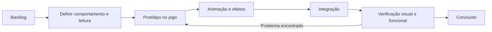

# Roadmap de animações de skills e variedade de inimigos

Status: primeiro pacote concluído em 24/10/2026: BASE-01, BASE-02 e SK-01.
Próximo cartão pronto: SK-02 (Dash). Os demais pacotes seguem no backlog.

Objetivo: deixar cada skill reconhecível durante o combate e ampliar as decisões
que o jogador toma ao enfrentar grupos de inimigos. Entregas pequenas, jogáveis
e verificadas à distância antes de avançar para o próximo lote.

## Ponto de partida

- O jogo usa Canvas 2D em um HTML independente, com sprites do Blender embutidos.
- Os seis inimigos comuns atuais são Guerreiro, Arqueiro, Bruto, Mago Vivo, Cão de Cripta e Acólito de Guerra.
  Seus especiais já têm preparação e formas de esquiva. Chefes existentes entram
  em uma etapa posterior de revisão.
- As ações equipáveis estão em `ACTION_SKILLS` e `TREE_ACTIONS`: Tiro de Osso,
  Dash, Muralha de Corpos, Escudo de Carne, Chuva de Ossos, Explosão Necrótica,
  Maldição da Fraqueza e as cinco famílias de invocação.
- Arqueiro morto-vivo e espectro já têm modelos, animações em oito direções e
  materiais clareados. Essa revisão estabelece a referência de legibilidade;
  não significa que as animações especiais das invocações estejam redesenhadas.

## Esteira de cada entrega

Manter no máximo um pacote em produção e um em verificação. Cada cartão tem
um ID, objetivo, dependências, estado e evidência de conclusão. Um pacote de
skill cobre uma habilidade; um de inimigo cobre um arquétipo completo, incluindo
comportamento, animação, aparição nas waves e recompensa.

Estados: **Backlog → Pronto → Em produção → Em verificação → Concluído**.
Bloqueios devem registrar o motivo e a dependência, sem marcar a entrega concluída.

## Ordem das entregas

| Marco | Pacote | Resultado jogável | Depende de |
| --- | --- | --- | --- |
| M0 | Base visual e arena de teste | Comparar efeitos e inimigos no tamanho real do jogo | — |
| M1 | Skills de uso frequente | Tiro de Osso e Dash com leitura clara | M0 |
| M2 | Primeiro lote de inimigos | Cão de Cripta e Acólito de Guerra | M1 |
| M3 | Skills de área e proteção | Chuva, Explosão, Muralha e Escudo | M1 |
| M4 | Segundo lote de inimigos | Guardião de Escudo e Cuspidor Pútrido | M2, M3 |
| M5 | Horda e sombras | Invocações, comandos especiais, maldição e auras | M3 |
| M6 | Terceiro lote e encontros | Carrasco de Correntes e Invocador de Ossos | M4, M5 |
| M7 | Elites e chefes | Revisão dos chefes e composições finais de waves | M6 |

Os marcos indicam sequência, sem prometer datas antes de medir a primeira entrega.
Após M2, revisar o tamanho dos lotes conforme o custo de produção e os resultados
em partidas. A meta proposta é passar de **4 para 10 arquétipos comuns** em três
lotes, sem contar chefes ou variações cosméticas como inimigos novos.

## Backlog inicial

| ID | Prioridade | Entrega | Critério específico | Estado |
| --- | --- | --- | --- | --- |
| BASE-01 | P0 | Guia visual do combate | Paleta, contraste, contornos e exemplos em 32/48/64 px; efeitos aliados e hostis distinguíveis também pela forma | Concluído |
| BASE-02 | P0 | Arena de teste visual | Selecionar skill/inimigo, repetir ações, alternar fundo e zoom, comparar isolado e em grupo; disponível apenas para desenvolvimento | Concluído |
| SK-01 | P1 | Tiro de Osso | Preparação curta, projétil com direção legível, impacto localizado e rastro discreto | Concluído |
| SK-02 | P1 | Dash | Início, deslocamento e saída reconhecíveis; efeito acompanha a trajetória real e termina com a invulnerabilidade | Pronto |
| EN-01 | P1 | Cão de Cripta | Perseguidor rápido com investida anunciada e recuperação explorável | Concluído |
| EN-02 | P1 | Acólito de Guerra | Suporte que fortalece aliados em uma área visível; efeito termina quando a fonte morre | Concluído |
| SK-03 | P1 | Chuva de Ossos | Área marcada, queda e impacto separados; borda da área de dano continua visível | Backlog |
| SK-04 | P1 | Explosão Necrótica | Expansão curta, centro identificável e dissipação rápida sem cobrir o chão por muito tempo | Backlog |
| SK-05 | P1 | Muralha de Corpos | Formação, permanência e dissolução; extensão visual corresponde à colisão | Backlog |
| SK-06 | P1 | Escudo de Carne | Ativação, escudo ativo, absorção de golpe e quebra distinguíveis | Backlog |
| EN-03 | P2 | Guardião de Escudo | Defesa frontal e abertura lateral/traseira; ataque anuncia a direção do escudo | Backlog |
| EN-04 | P2 | Cuspidor Pútrido | Projétil lento e poça temporária anunciada; limite perigoso permanece identificável | Backlog |
| SK-07 | P2 | Aparição das cinco invocações | Entrada coerente por família, sem esconder inimigos ou reiniciar recuperação | Backlog |
| SK-08 | P2 | Explosão do zumbi | Unidade escolhida claramente marcada; detonação, impacto e ausência durante a recuperação | Backlog |
| SK-09 | P2 | Tiro forte dos arqueiros | Puxada do arco, soltura e impacto diferentes do tiro básico | Backlog |
| SK-10 | P2 | Salto da abominação | Saída, sombra de destino, voo e aterrissagem sincronizados com o dano | Backlog |
| SK-11 | P2 | Comando dos esqueletos guerreiros | Mapear o efeito atual e criar animação própria sem inventar outra mecânica durante a revisão visual | Backlog |
| SK-12 | P2 | Passo Espectral | Origem e destino legíveis; rastro curto sem duplicatas persistentes | Backlog |
| SK-13 | P2 | Maldição da Fraqueza e auras | Aplicação e estado ativo distinguíveis; marcadores discretos em grupos grandes | Backlog |
| EN-05 | P3 | Carrasco de Correntes | Ataque linear que controla espaço, com aviso de trajetória e janela de esquiva | Backlog |
| EN-06 | P3 | Invocador de Ossos | Ritual interrompível e limite de invocações simultâneas; morte encerra o ritual | Backlog |
| EN-07 | P3 | Composição das waves | Misturas com funções complementares e introdução gradual de cada inimigo | Backlog |
| EN-08 | P3 | Elites e chefes existentes | Silhueta, preparação e recuperação próprias; ataques continuam evitáveis | Backlog |
| QA-01 | Contínua | Regressão e desempenho | Registrar comparação antes/depois em cada entrega | Backlog |

## Direção visual das skills

Usar uma linguagem comum: **preparação → execução → impacto → dissipação**.
Nem toda habilidade precisa de uma preparação nova; a animação acompanha o
comportamento e as janelas que já existem.

- Ossos: marfim, fragmentos grandes e direção definida; poucos estilhaços pequenos.
- Carne: tons orgânicos médios, massa e pulsação; contornos internos discretos.
- Espíritos: azul/ciano, formas leves e rastros curtos; brilho concentrado.
- Sombras/maldições: violeta, símbolos e bordas claras; evitar círculos pretos opacos.
- Perigo inimigo: combinar cor com forma e movimento. O aviso persiste até o
  momento correspondente da ação e permite entender onde é seguro ficar.

Usar Blender para poses, movimentos de personagens e objetos com volume. Usar
Canvas para áreas no chão, rastros e partículas que precisem acompanhar a posição
real de combate. Preservar os sprites de oito direções quando a ação depender
da orientação; efeitos radiais não precisam de oito versões idênticas.

Nas entregas de redesenho, preservar custo, alcance, dano, colisões e recargas.
Qualquer mudança de balanceamento vira um cartão próprio, com comparação explícita.

## Regras para os novos inimigos

Cada arquétipo deve ter silhueta e função próprias, ataque básico, especial,
preparação, recuperação e morte. Cor diferente ou mais HP não bastam.

| Arquétipo proposto | Decisão que cria | Resposta possível do jogador |
| --- | --- | --- |
| Cão de Cripta | Reagir a uma aproximação rápida | Esquivar lateralmente e punir a recuperação |
| Acólito de Guerra | Priorizar a fonte de fortalecimento | Separar o grupo ou eliminar o suporte |
| Guardião de Escudo | Escolher o ângulo de ataque | Flanquear ou aproveitar a abertura do ataque |
| Cuspidor Pútrido | Administrar o espaço seguro | Sair da poça e reposicionar a horda |
| Carrasco de Correntes | Ler ameaças em linha | Cruzar a trajetória antes do golpe ou sair de seu alcance |
| Invocador de Ossos | Interromper uma ameaça crescente | Atacar durante o ritual; sobreviver sem crescimento ilimitado |

Introduzir cada inimigo sozinho, depois com um tipo conhecido, e só então em
grupos com outras funções. Os valores de HP, dano, velocidade, frequência e
recompensa serão definidos e testados na entrega de cada arquétipo.

Usar IDs estáveis nas novas definições. O jogo atual acessa `ENEMY_TYPES` por
índice em waves e campanha: preservar os índices existentes ou migrar todos os
consumidores antes de reorganizar a lista. Atualizar também o simulador quando
a nova mecânica puder afetar suas conclusões; registrar o que ele ainda não modela.

## Critério de conclusão de cada cartão

- [ ] Ação legível no zoom real, em miniaturas de 32/48/64 px e em fundos claros/escuros.
- [ ] Silhueta, arma, olhos e área de perigo não viram manchas pretas à distância.
- [ ] Antes/depois registrado, incluindo uma cena com horda e inimigos em movimento.
- [ ] Preparação, colisão e impacto sincronizados; morte/interrupção cancelam o que devem cancelar.
- [ ] Sprite sem recorte nas direções aplicáveis; animações não deixam resíduos após troca de fase.
- [ ] Fonte editável e geração reproduzível disponíveis; HTML distribuído atualizado.
- [ ] Sem erro de navegador, regressão de saves, controles ou progressão relacionada.
- [ ] Desempenho comparado na mesma cena/dispositivo e com qualidade baixa; medir tempo
  de quadro e volume de efeitos ativos. Definir o orçamento em BASE-02 e registrar desvios.

Verificações conforme o escopo: `node game_check.js`, testes dos modelos de
skills/waves, simulações pertinentes e verificação no navegador. Para sprites,
usar a conferência de carregamento e animações existente em
`scripts/undead-sprites-browser-check.js` como ponto de partida, ampliando-a
quando novos personagens forem integrados.

## Primeiro pacote — concluído

**M0 + SK-01: base de leitura e Tiro de Osso.**

1. Registrar o efeito atual em situação isolada e com combate cheio.
2. Fixar o guia de contraste e criar a arena de comparação.
3. Redesenhar preparação, projétil e impacto do Tiro de Osso.
4. Conferir leitura pequena e sincronização com colisão/dano.
5. Integrar ao HTML, validar e registrar evidências no cartão SK-01.

Depois: SK-02 e EN-02; EN-01 concluído. Atualizar estados neste documento ao iniciar e
concluir cada pacote. Este roadmap organiza o trabalho; não agenda execuções automáticas.

### Evidência da entrega de 24/10/2026

- [Guia visual e instruções da arena](guia-visual-combate.md), com paleta, limites de efeitos e critérios de leitura.
- Arena em `tools/combat-lab.html`, servida por `node tools/combat-lab-server.js`.
  Compartilha os sprites reais e o renderizador novo com o jogo; colisão e IA
  são verificadas separadamente no HTML jogável.
- Tiro de Osso integrado ao HTML: saída curta, osso direcional, rastro discreto,
  impacto localizado e iluminação reduzida, sem mudança dos parâmetros de combate.
- [Comparação isolada](concepts/tiro-osso-comparacao.png),
  [grupo distante](concepts/tiro-osso-grupo-distante.png) e
  [impacto](concepts/tiro-osso-impacto.png).
- 70 cenários do jogo aprovados. Teste de navegador aprovado para controles da
  arena, oito direções, parâmetros reais do disparo, expiração e limite dos efeitos.
- Cena animada com 32 inimigos e seis aliados, escala 24 px/u e qualidade baixa:
  P95 de desenho de **3,4 ms** em 100 amostras, nos dois painéis, em Chrome headless
  nesta máquina. A meta local inicial é 4 ms; isso não mede o quadro completo do jogo.
- QA-01 permanece contínuo; as próximas skills e os novos inimigos ainda precisam
  de suas próprias verificações e evidências.

## EN-01 — Cão de Cripta concluído

- Quadrúpede ósseo com modelo/rig Blender e sete animações em oito direções (272 quadros sem recorte).
- Mordida, investida em linha fixa com colisão contínua, pausa vulnerável e cancelamento por morte/reset. A horda reconhece o corredor como perigo.
- Introdução nas waves e expedições a partir da wave 4; campanha e índices originais preservados.
- HTML independente atualizado; modelos e teste do simulador acompanham a composição nova. Esquiva lateral e colisão continuam aproximações no simulador matemático.
- Evidências e reprodução: [validação do Cão](../review/crypt-hound-validation.md). EN-02 permanece no backlog.

## EN-02 — Acólito de Guerra

Concluído em 25/10/2026: modelo e rig originais, seis animações em oito direções,
ritual anunciado e aura de dano sem acúmulo, integração na Arena e Expedições
a partir da wave 6. Morte/reset/perda de alerta removem a contribuição da fonte.
Fontes editáveis em `blender/scripts/war_acolyte.py` e módulos `scripts/war-acolyte*`.
Evidências, comandos, medição local e limites do simulador estão em
[review/war-acolyte-validation.md](../review/war-acolyte-validation.md).
